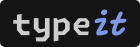

<p align="center">  </p>

This is very simple Typst project for static site generation.

My goal is to create very simple tool that creates very simple page using
Typst. No noise. Just put your thoughts in the documents. Type it.

> [!WARNING]
> This builds on Typst HTML exports, which is experimental feature.

Styles are split into three files, loaded in this order:

1. `styles/vague.css`: the color palette and semantic color variables.
2. `styles/components.css`: shared layout, typography, and components.
3. `styles/custom.css`: site fonts and custom overrides.

To add a theme, create a CSS file defining the same semantic variables as
`vague.css`, export it as an asset in `index.typ`, and select it with
`#show: template.with("your-theme")`. Components use the semantic variables
(`--bg`, `--fg`, `--info`, etc.), so themes can use their own palette names.
Keep font declarations and site-specific changes in `custom.css`.

Themes have two sets of variables: their own palette (any names and any number
of colors), and the public roles used by components. Every public role is
documented in `styles/vague.css` and `styles/rosepine.css`, including where it
is used and what kind of color to choose. Keep these role names the same in
every theme; palette names can differ.

A role does not need a unique color. For example, Rosé Pine's foam supplies
`--info`, `--success`, and `--table-heading`. Define the hex value once in the
palette and reuse it with `var(...)`. Status names describe intent, so a theme
without green can choose another readable accent for success. Callout header
backgrounds are automatically tinted from their status color by the shared CSS.

The included Rosé Pine themes use the palettes from
[the official palette](https://rosepinetheme.com/palette/):

| Theme name | Variant | Color scheme |
| --- | --- | --- |
| `rosepine` | Main | Dark |
| `rosepine-moon` | Moon | Dark |
| `rosepine-dawn` | Dawn | Light |

Set `#let theme = "rosepine-moon"` (or another name above) in the example
`index.typ`. All three CSS assets and matching logos are included. Each page
loads only its selected theme. When using the template directly, select a
variant with e.g. `#show: template.with("rosepine-dawn")`.

Callouts can use either `callout` or `admonition` as their base class, with
`note`, `info`, `tip`, `success`, `warning`, `caution`, `danger`, or `error`
as a variant. For example, in Typst:

```typst
#html.elem("aside", attrs: (class: "callout warning"))[
  #html.elem("p", attrs: (class: "callout-title"))[Warning]
  Check your configuration before continuing.
]
```
